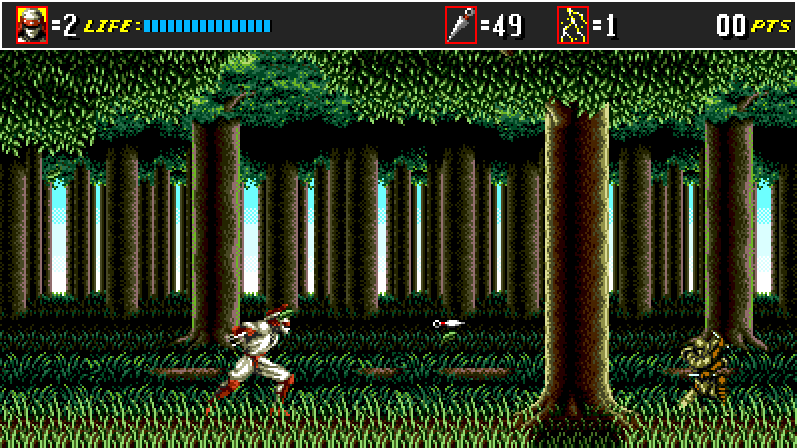
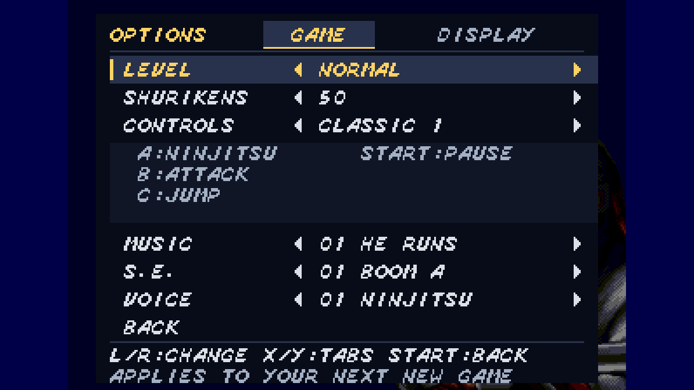
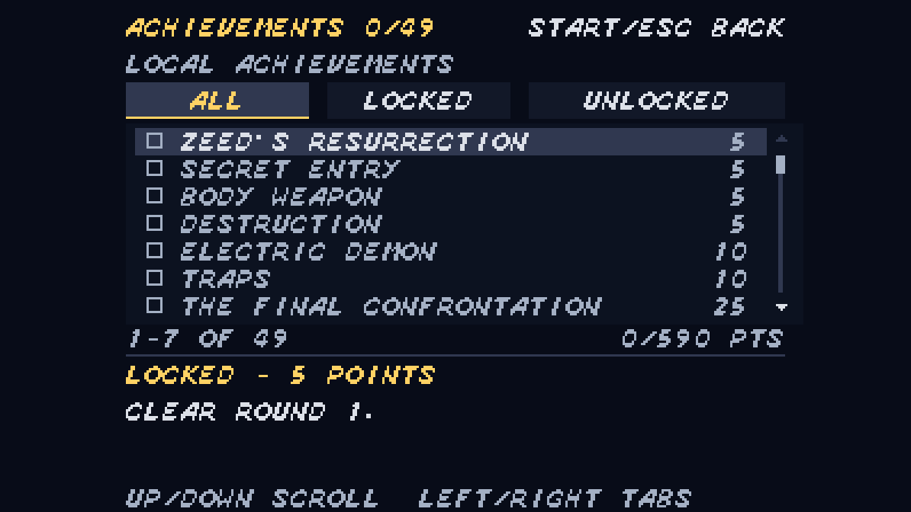

<p align="center">
  
</p>

<p align="center">
  <b>Widescreen action · Keyboard &amp; controller · Save slots · CRT display options</b><br>
  <a href="https://github.com/krazyjakee/ninja-master/releases">Downloads</a> ·
  <a href="#getting-started">Getting started</a> ·
  <a href="#compatible-rom">Compatible ROM</a> ·
  <a href="#how-to-play">How to play</a> ·
  <a href="LICENSE">MIT license</a>
</p>

**Ninja Master** brings *Shinobi III: Return of the Ninja Master* to the desktop
with native gameplay, widescreen presentation, rebindable controls and quick
saves. Graphics, music, sound and stage data load directly from your own cartridge dump.

This complete, unofficial port includes all seven rounds and is playable from
start to finish. Full playthroughs have been tested on **Linux and Windows**.

## Screenshots

**First level — Round 1-1**



| Options | Achievements |
| --- | --- |
|  |  |

## Getting started

1. Download a package for your platform from [Releases](https://github.com/krazyjakee/ninja-master/releases).
2. Have your own [compatible ROM](#compatible-rom) ready. No ROM or original game assets are included.
3. Install or extract it as described below, then launch **Ninja Master**.
4. Choose your ROM in the startup file picker. The game remembers its location for next time.
5. Press **Enter**, select **NEW GAME**, and press **Enter** again.

You can also name your dump `shinobi3_us.bin` and put it beside the executable
(beside the `.app` on macOS). For a different location, pass `--rom`:

```sh
./ninja-master-native --rom "/path/to/your/game.bin"
```

On Windows, use `ninja-master-native.exe --rom "C:\path\to\your\game.bin"`.
The `NINJA_MASTER_ROM` environment variable can also point to your ROM.

| Platform | Download | Install and launch |
| --- | --- | --- |
| Windows 10/11, 64-bit | `.msi` installer | Open the MSI, then launch **Ninja Master** from the Start menu. Installs for your user account. |
| Windows portable | `.zip` | Extract the folder and open **play.bat**. Keep `SDL2.dll` beside the executable. |
| Debian / Ubuntu, 64-bit | `.deb` | Run `sudo apt install ./ninja-master-*-linux-x86_64.deb`, then launch **Ninja Master** from your app menu. |
| Fedora / RPM Linux, 64-bit | `.rpm` | Run `sudo dnf install ./ninja-master-*-linux-x86_64.rpm`, then launch **Ninja Master** from your app menu. |
| Linux portable | `.tar.gz` | Extract the folder and run **play.sh**. Install your distribution's SDL2 runtime first. |
| macOS 15+, Intel | `macos-x86_64.dmg` | Open the DMG, drag **Ninja Master.app** into Applications, then open it. |
| macOS 15+, Apple Silicon | `macos-arm64.dmg` | Open the DMG, drag **Ninja Master.app** into Applications, then open it. |

Windows and macOS downloads bundle SDL2; they do not need a separate SDL2
installation. DEB and RPM packages install their runtime dependencies through
your package manager. Linux builds are tested on Ubuntu 24.04 and Fedora;
older distributions may need newer system libraries.

Windows installers are not publisher signed. Mac apps are ad-hoc signed and
not notarized. If macOS blocks the first launch, use
**System Settings → Privacy & Security → Open Anyway**.
Uninstalling the Windows application preserves ROM files you add and your
settings and saves. Each download has a `.sha256` file for verifying its checksum.

## Compatible ROM

The following original 1993 retail cartridge dumps are supported. Each must be
**1,048,576 bytes** (1 MiB), in plain big-endian binary `.bin` format without
a copier header or SMD interleaving. Filenames do not establish compatibility.

| Region / version | CRC32 | SHA-1 |
| --- | --- | --- |
| USA — Shinobi III, `MPR-15674-F` | `5381506f` | `1e07d7998e3048fcfba4238ae96496460e91b3a5` |
| Europe — Shinobi III, `MPR-15798 T57` | `0b6d3eb5` | `23579c8f7e2396080b478b113aff36d2382395a3` |
| Japan / Korea — The Super Shinobi II | `5b412816` | `e3dbe326aa93320d405c561c306fc3954ab8ea7c` |

These identities match [MAME's Mega Drive cartridge catalog](https://github.com/mamedev/mame/blob/master/hash/megadriv.xml).
Startup reports the detected release and rejects modified, prototype, zipped
and interleaved images. Supply a dump of your own compatible cartridge.
The Japanese version uses its own relocated data and Japanese story/ending font and text.
All regions run at the native port's **60 Hz** simulation/audio cadence; the
European ROM does not switch the application to PAL 50 Hz.

To check SHA-1, use `sha1sum game.bin` on Linux, `shasum -a 1 game.bin` on macOS,
or `Get-FileHash -Algorithm SHA1 game.bin` in Windows PowerShell.

## How to play

Default controls follow the Mega Drive three-button layout:

| Action | Keyboard | Controller |
| --- | --- | --- |
| Move / crouch | Arrow keys | D-pad or left stick |
| Ninjutsu (A) | **A** or **Z** | West face button |
| Attack (B) | **S** or **X** | South face button |
| Jump (C) | **D**, **C** or **Space** | East face button |
| Start / pause | **Enter**; **Escape** also pauses during play | Start |

- **Run:** double-tap Left or Right.
- **Jump:** hold Jump for more height. Press Jump again near the top of a jump to somersault.
- **Attack:** use Attack to throw a shuriken; nearby enemies select a melee attack.
- **Hang:** hold Up while jumping toward a ceiling or hang bar. Move along it with Left/Right; Down + Jump drops and Up + Jump climbs where possible.
- **Ninjutsu:** press A/Z to use your selected technique. Pause, choose a technique with the directions, then resume with Enter.
- **Quit during play:** pause, then press Attack followed by Jump.

The title's **OPTIONS** menu has **Game** and **Display** tabs. Game adjusts
difficulty, starting shurikens and control scheme. **DISABLE** is a distinct melee-only shuriken setting: it hides the ammo
HUD, suppresses shuriken pickups and ranged attacks, and follows the run through
deaths, continues, stages and saves. Finite aerial bursts fire only the ammunition
remaining. Techniques can be selected with zero uses; casting still requires a use.
These choices and your bindings persist across application restarts.
Choose a classic layout, **6 BUTTON**, or **DEDICATED**. All keyboard and
controller bindings can be changed or restored in **F1 → Controls**, where the
scheme selector and action names explain each input.

| Pad input | Six-button action | Dedicated action | Default keyboard | Default controller |
| --- | --- | --- | --- | --- |
| A | Guard | Ninjutsu | A / Z | West face |
| B | Melee | Melee | S / X | South face |
| C | Jump | Jump | D / C / Space | East face |
| X | Shuriken | Shuriken | Q | Left shoulder |
| Y | Shuriken | Guard | W | Right shoulder |
| Z | Ninjutsu | Ninjutsu | E | North face |
| Mode | Cycle technique | Cycle technique | Tab | Back / View |
| Start | Pause / confirm | Pause / confirm | Enter | Start |

Guard works immediately, without throwing first. Melee remains available with
no ammunition; an empty dedicated shuriken action does nothing. Classic attack
retains the original proximity-based choice.

Menus support keyboard, controller and mouse together. Hover selects a row;
click activates it. In Options, click the Game or Display tab, use pad **X/Y**
(**Q/W** or the controller shoulders by default), or move Up from the first
setting and use Left/Right to change tabs. Each tab keeps its settings visible.
Use the arrows or click the left or right side of a value to change it. Click a sound-test label to play
it; right-click anywhere on its row to stop it, including voice previews.
Hold a direction to repeat navigation or value changes. The footer explains
the selected setting and confirms sound-test actions.
The S.E. list also includes the two driver effects omitted by the original menu,
labelled **SFX $AB** and **SFX $D7** because the ROM provides no names.
Use the wheel or directions to scroll. Arrows indicate more rows above or below;
keyboard/controller selection stays visible and returning from Options preserves
main-menu focus. **Escape** or controller **Back / View** goes back, cancels a confirmation or resumes pause.
**Start** skips the SEGA logo at any point without activating the next screen.

**NEW GAME** starts a fresh run with your chosen options and asks before replacing
an existing saved run. **CONTINUE** resumes the latest automatic checkpoint,
including position, health, ammunition, lives, score, technique and run options.
Checkpoints are saved every five seconds of simulation, at mode transitions,
and on normal application exit, in `continue.nms` beside your settings.
Continue restores gameplay directly, including when the checkpoint was taken
while paused or showing a round card. Completed or exhausted runs clear it.
Continue is hidden when there is no compatible checkpoint; damaged or
incompatible files produce a message without starting a game. It is separate
from the original game-over continues and the eight manual save slots.

## Practice

Choose **PRACTICE** on the main menu, then **Explore** or **Time Trial**. Both
stage lists unlock each stage only after you clear it in the normal game.
Previously earned round-clear achievements also unlock that round's stages.
Use **Escape**, controller **Back / View**, or **A** (A/Z or the west face
button by default) to return one menu level; you can also click the back label.
**Enter / Start**, Attack or Jump confirms your selection.

**Explore** keeps the stage's terrain, hazards and pickups, with enemies and
bosses removed. **Time Trial** keeps the enemies and races a cyan ghost of your
fastest completed attempt. Its stage list shows every saved best time. Clears
and failed attempts return to the stage list; pause and choose Quit to Menu to
return there early. Pause stops the trial clock. Death ends an attempt, and
cheats or simulation modifiers prevent a new record.

Best times and ghosts persist in `profile.json`. Practice leaves your normal
Continue checkpoint intact and does not unlock stages or achievements. Manual
saving is unavailable during these practice sessions.

## Achievements and statistics

The main menu now includes **Achievements** and **Statistics**, with keyboard,
controller and mouse navigation. Browse all **49 local achievements** (590 points),
filter by locked/unlocked state, read requirements and see unlock notifications.
The Statistics screen has Standard, Practice and Best Times tabs. Run and lifetime
values use labelled columns; select a row to read exact values. Hold Up/Down,
use the mouse wheel or click the scroll controls to browse; Left/Right changes
tabs. Unlock popups wait until you leave these screens. Statistics include active
playtime, completions, deaths, continues, enemy defeats, shurikens, melee hits, magic,
collected items and best round times.

Start **New Game** for eligible achievement progress. Automatic **Continue**
preserves it. Manual save loads, cheats, developer stage starts and simulation
modifiers mark the run as Practice; display/control settings and ordinary pause
are allowed, as is starting with **Disable shurikens**. The profile persists in
`profile.json` beside your settings and protects lifetime totals against replaying
old saves.

Achievements are local equivalents of the public RetroAchievements set;
**they are not submitted to or verified by RetroAchievements**. Account
integration is unavailable under its current native-port policy. See
[the complete condition mapping and persistence rules](native/ACHIEVEMENTS.txt).

## Make it yours

Press **F1** to open the companion panel. The game continues running while the
panel is open; pause first if you need time to adjust settings.

| Shortcut | Action |
| --- | --- |
| **F1** | Controls, audio, saves and tools panel |
| **F2** | Toggle performance overlay |
| **F3** | Guided control rebinding |
| **F5 / F6** | Save / load the selected save slot |
| **F7 / F8** | Smaller / larger window |
| **F9 / F10** | Lower / raise volume |
| **F11** | Toggle fullscreen |
| **F12** | Save a PNG screenshot |

Open **Options → Display** on the title menu for three groups:

- **Window:** fullscreen, window size, and widescreen or the original view.
- **Scaling:** aspect ratio and integer scaling for sharp whole pixels or a larger image.
- **Effects:** scenery waves, CRT filter, curvature, and scanline strength.

Changes preview immediately and persist across restarts. Widescreen adapts to
your window or monitor, including ultrawide displays. Dependent controls explain
when they are unavailable. Click a percentage bar to set curvature or scanlines;
**Reset Display** restores these nine display preferences without changing game,
audio, or control settings. F7/F8 and F11 remain available during play.
**F2** shows current and average FPS, frame time, a scrolling 240-frame graph,
CPU raster/upload/submission times, presentation wait, sprite count, upload size
and rendering resolutions. Measurements describe presentation and leave the
60 Hz simulation unchanged. F1 and F2 can be shown together; F1 has priority
where their panels overlap in small windows.

**F12** saves the displayed game viewport at its displayed pixel dimensions and
aspect ratio, including the game HUD and CRT/scanline effects. Desktop panels,
the F2 overlay, desktop notifications and letterboxing are excluded. In-game
achievement notifications are included. Files go into
`screenshots/` beside `settings.ini` (or the working directory if no configuration
folder is available), with unique names. A brief message shows the saved path or
failure. PNG encoding runs in a background worker; holding F12 saves once.

**Controls** lets you rebind keys and choose a controller.
**Saves** provides eight slots. **Art packs** lets you select custom artwork or
return to the original graphics from your ROM.

Settings and saves persist in your user configuration folder:

| Platform | Folder |
| --- | --- |
| Windows | `%APPDATA%\ninja-master\` |
| macOS | `~/Library/Application Support/ninja-master/` |
| Linux | `$XDG_CONFIG_HOME/ninja-master/` or `~/.config/ninja-master/` |

## Gameplay comparison checks

Focused cartridge tests and numeric original-ROM traces are described in
[native/tests/data/fidelity.txt](native/tests/data/fidelity.txt). The double-jump
movement and animation matched the original sample; their tuning is preserved.
Classic melee now samples proximity before turning, as the original does. The
first forest boss exit walks into the broken opening and transitions before
Joe reaches the pit beyond it.

## Rendering development

The desktop uploads each game frame only to its active presentation path. F2
reports CPU composition, RGB resolution, upload and presentation costs separately.
The CPU renderer remains the gameplay and headless fidelity reference.

Run `python3 tools/benchmark_rendering.py --out out/rendering --frames 60` for
procedural native/HD, widescreen/ultrawide and CRT benchmarks at 1080p, 1440p and
4K. Add `--rom /path/to/game.bin` for real stage samples. A desktop OpenGL display
is required. Results include raw samples, timing distributions, transfer counts,
hardware metadata and pixel comparisons for the experimental GPU tile atlas.
See [rendering measurements and backend decisions](tools/rendering/README.md).

## License

The project's original code and app artwork are available under the
[MIT license](LICENSE). Third-party dependencies retain their own licenses;
binary packages include their notices.

*Shinobi III*, its characters and original game content belong to Sega. This
project is not affiliated with or endorsed by Sega. The repository and release
archives do not include ROMs, extracted game assets, music or disassembled game
code. The MIT license does not grant rights to the original game content.
