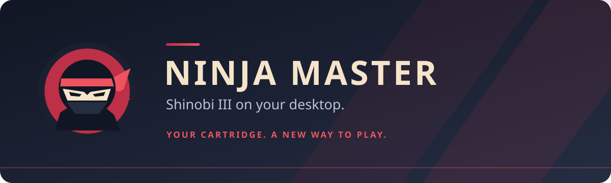

<p align="center">
  
</p>

<p align="center">
  <b>Widescreen action · Keyboard &amp; controller · Save slots · CRT display options</b><br>
  <a href="https://github.com/krazyjakee/ninja-master/releases">Downloads</a> ·
  <a href="#getting-started">Getting started</a> ·
  <a href="#compatible-rom">Compatible ROM</a> ·
  <a href="#how-to-play">How to play</a> ·
  <a href="LICENSE">MIT license</a>
</p>

**Ninja Master** brings *Shinobi III: Return of the Ninja Master* to the desktop
with native gameplay, widescreen presentation, rebindable controls and quick
saves. Graphics, music and stage data load directly from your own cartridge dump.

This is an unofficial, work-in-progress port. All seven rounds are accessible,
but movement, encounters and sound can differ from the original game; a complete
playthrough is not guaranteed in this version.

## Getting started

1. Download a package for your platform from [Releases](https://github.com/krazyjakee/ninja-master/releases).
2. Have your own [compatible US ROM](#compatible-rom) ready. No ROM or original game assets are included.
3. Install or extract it as described below, then launch **Ninja Master**.
4. Choose your ROM in the startup file picker. The game remembers its location for next time.
5. Press **Enter**, select **GAME**, and press **Enter** again.

You can also name your dump `shinobi3_us.bin` and put it beside the executable
(beside the `.app` on macOS). For a different location, pass `--rom`:

```sh
./ninja-master-native --rom "/path/to/your/game.bin"
```

On Windows, use `ninja-master-native.exe --rom "C:\path\to\your\game.bin"`.
The `NINJA_MASTER_ROM` environment variable can also point to your ROM.

| Platform | Download | Install and launch |
| --- | --- | --- |
| Windows 10/11, 64-bit | `.msi` installer | Open the MSI, then launch **Ninja Master** from the Start menu. Installs for your user account. |
| Windows portable | `.zip` | Extract the folder and open **play.bat**. Keep `SDL2.dll` beside the executable. |
| Debian / Ubuntu, 64-bit | `.deb` | Run `sudo apt install ./ninja-master-*-linux-x86_64.deb`, then launch **Ninja Master** from your app menu. |
| Fedora / RPM Linux, 64-bit | `.rpm` | Run `sudo dnf install ./ninja-master-*-linux-x86_64.rpm`, then launch **Ninja Master** from your app menu. |
| Linux portable | `.tar.gz` | Extract the folder and run **play.sh**. Install your distribution's SDL2 runtime first. |
| macOS 15+, Intel | `macos-x86_64.dmg` | Open the DMG, drag **Ninja Master.app** into Applications, then open it. |
| macOS 15+, Apple Silicon | `macos-arm64.dmg` | Open the DMG, drag **Ninja Master.app** into Applications, then open it. |

Windows and macOS downloads bundle SDL2; they do not need a separate SDL2
installation. DEB and RPM packages install their runtime dependencies through
your package manager. Linux builds are tested on Ubuntu 24.04 and Fedora;
older distributions may need newer system libraries.

These preview installers are not publisher signed or notarized. If macOS
blocks the first launch, use **System Settings → Privacy & Security → Open Anyway**.
Uninstalling the Windows application preserves ROM files you add and your
settings and saves. Each download has a `.sha256` file for verifying its checksum.

## Compatible ROM

**Only the original 1993 USA / NTSC-U release of _Shinobi III: Return of the
Ninja Master_ for Sega Genesis is supported.** The exact compatible image is
identified below; its filename alone does not establish compatibility.

| Property | Required value |
| --- | --- |
| Game / version | Shinobi III: Return of the Ninja Master — USA, 1993 retail release |
| Cartridge ROM | `MPR-15674-F` (MAME entry `shinobi3u`) |
| Format | Plain, big-endian binary `.bin`; no copier header or SMD interleaving |
| Size | **1,048,576 bytes** (1 MiB) |
| CRC32 | `5381506f` |
| SHA-1 | `1e07d7998e3048fcfba4238ae96496460e91b3a5` |

The ROM identity matches [MAME's Mega Drive cartridge catalog](https://github.com/mamedev/mame/blob/master/hash/megadriv.xml).
European/PAL, Japanese (*The Super Shinobi II*), modified, zipped and interleaved
images are not accepted. Supply a dump of your own compatible cartridge.

To check SHA-1, use `sha1sum game.bin` on Linux, `shasum -a 1 game.bin` on macOS,
or `Get-FileHash -Algorithm SHA1 game.bin` in Windows PowerShell. The result must
match the table above. Startup also checks the image size, header and CRC32.

## How to play

Default controls follow the Mega Drive three-button layout:

| Action | Keyboard | Controller |
| --- | --- | --- |
| Move / crouch | Arrow keys | D-pad or left stick |
| Ninjutsu (A) | **A** or **Z** | West face button |
| Attack (B) | **S** or **X** | South face button |
| Jump (C) | **D**, **C** or **Space** | East face button |
| Start / pause | **Enter**; **Escape** also pauses during play | Start |

- **Run:** double-tap Left or Right.
- **Jump:** hold Jump for more height. Press Jump again near the top of a jump to somersault.
- **Attack:** use Attack to throw a shuriken; nearby enemies select a melee attack.
- **Hang:** hold Up while jumping toward a ceiling or hang bar. Move along it with Left/Right; Down + Jump drops and Up + Jump climbs where possible.
- **Ninjutsu:** press A/Z to use your selected technique. Pause, choose a technique with the directions, then resume with Enter.
- **Quit during play:** pause, then press Attack followed by Jump.

The title's **OPTIONS** menu adjusts difficulty, starting shurikens and control
type. Six-button mode adds guarding, separate melee/shuriken inputs and technique
cycling; all bindings can be changed in **F1 → Controls**.

## Make it yours

Press **F1** to open the companion panel. The game continues running while the
panel is open; pause first if you need time to adjust settings.

| Shortcut | Action |
| --- | --- |
| **F1** | Display, controls, audio and saves panel |
| **F5 / F6** | Save / load the selected save slot |
| **F7 / F8** | Smaller / larger window |
| **F9 / F10** | Lower / raise volume |
| **F11** | Toggle fullscreen |

**Display** offers widescreen that adapts to your window or monitor, including
ultrawide displays, the original 320×224 view, optional CRT effects and scanlines.
Integer scaling preserves whole pixels; turn it off to use the full display height.
**Controls** lets you rebind keys and choose a controller.
**Saves** provides eight slots. **Art packs** lets you select custom artwork or
return to the original graphics from your ROM.

Settings and saves persist in your user configuration folder:

| Platform | Folder |
| --- | --- |
| Windows | `%APPDATA%\ninja-master\` |
| macOS | `~/Library/Application Support/ninja-master/` |
| Linux | `$XDG_CONFIG_HOME/ninja-master/` or `~/.config/ninja-master/` |

## License

The project's original code and app artwork are available under the
[MIT license](LICENSE). Third-party dependencies retain their own licenses;
binary packages include their notices.

*Shinobi III*, its characters and original game content belong to Sega. This
project is not affiliated with or endorsed by Sega. The repository and release
archives do not include ROMs, original game artwork, music or disassembled game
code. The MIT license does not grant rights to the original game content.
